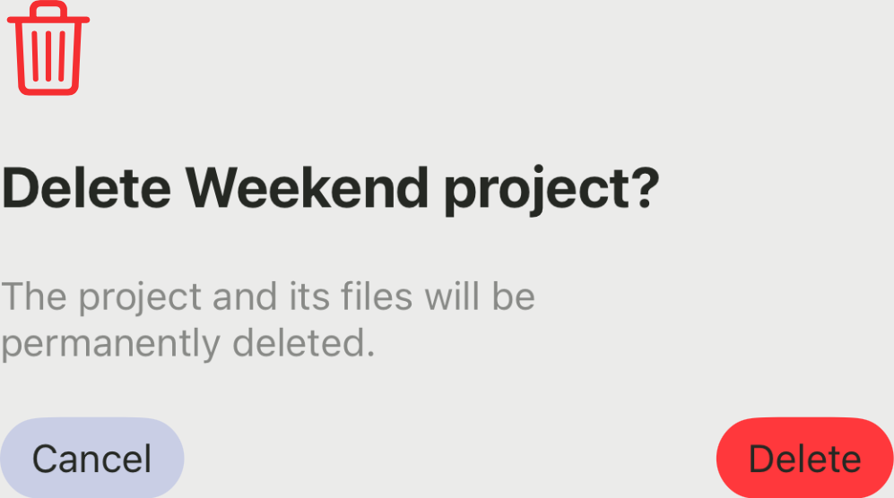
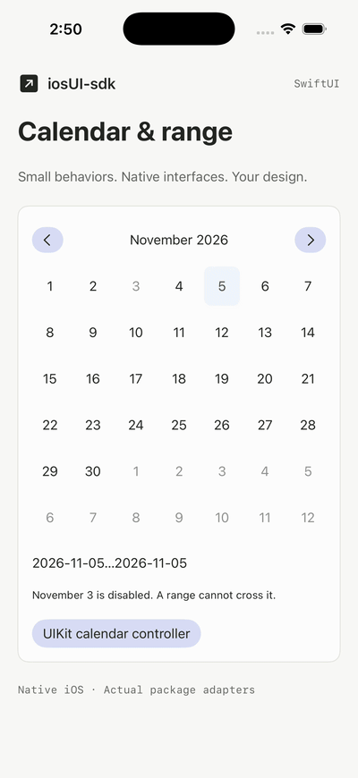
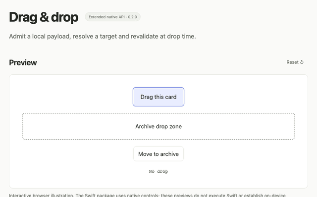
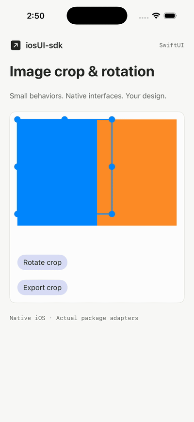

# iosUI-sdk

**Interaction state for SwiftUI and UIKit.**

An independent, Apache-2.0 native adaptation of [UI SDK](https://github.com/vercel-labs/ui)'s behavior-driven approach for SwiftUI and UIKit. Compose interaction rules instead of copying custom controls between apps. No JavaScript runtime, network services, or third-party package dependencies.

The package includes foundational and extended native behavior families. It does not claim feature-complete parity with every web recipe. See [coverage and differences](docs/coverage.md).

[Browse the documentation and interactive previews](https://killa-kyle.github.io/iosUI-sdk/docs/).

## Build a component with a behavior

Import a behavior, bind your state, and write your SwiftUI view.
[See three complete components beside their native iOS screenshots](https://killa-kyle.github.io/iosUI-sdk/examples/).

This confirmation button uses `Disclosure` for open/dismiss state and
`behaviorSheet` for native presentation. The view supplies its own content and actions.

```swift
import SwiftUI
import UIBehaviorCore
import UIBehaviorSwiftUI

struct DeleteProjectButton: View {
  let project: String
  let onDelete: () -> Void
  @State private var confirmation = Disclosure()

  var body: some View {
    Button("Delete project", role: .destructive) { confirmation.open() }
      .buttonStyle(.bordered)
      .behaviorSheet($confirmation) {
        VStack(alignment: .leading, spacing: 20) {
          Image(systemName: "trash").font(.largeTitle).foregroundStyle(.red)
          Text("Delete \(project)?").font(.title2.bold())
          Text("The project and its files will be permanently deleted.")
            .foregroundStyle(.secondary)
          HStack {
            Button("Cancel") { confirmation.dismiss(.action) }
              .buttonStyle(.bordered)
            Spacer()
            Button("Delete", role: .destructive) {
              confirmation.dismiss(.action)
              onDelete()
            }.buttonStyle(.borderedProminent).tint(.red)
          }
        }
        .accessibilityElement(children: .contain)
        .accessibilityIdentifier("confirmation-content")
        .padding(28)
        .presentationDetents([.height(300)])
      }
  }
}
```

Use it in your app:

```swift
DeleteProjectButton(project: "Weekend project") {
  deleteProject()
}
```



Two more complete recipes:

| Component | Behavior adapter | Source |
| --- | --- | --- |
| Plan picker | `Selection` + `BehaviorChoiceList` | [PlanPicker.swift](Examples/Catalog/Recipes/PlanPicker.swift) |
| Expandable tool activity | `Disclosure` + `BehaviorDisclosure` | [ToolActivity.swift](Examples/Catalog/Recipes/ToolActivity.swift) |

Each example compiles in the native catalog. The published code is generated from
these Swift files, so the example and the running component share the same source.

## Native examples

Real iOS simulator recordings of the package's SwiftUI adapters, styled with the
same palette as the documentation site. Drag/drop and crop retain actual gesture
motion; these are not browser previews or animated mockups.

**Calendar ranges**



**Drag and drop**



**Crop, rotate and export**



[Reproduce these recordings](docs/media/README.md).

## Streaming chat

Version 0.3.0 adds reading-position restoration, activity expansion state and
native keyboard/reserved-region observations. The Streaming chat catalog story
uses real ScrollView/TextField controls and a local cancellable stream. Read the
[composition guide](docs/chat-interactions.md) and
[reference interaction evidence](docs/reference-interactions.md).

## Build with an agent

Install the consumer skill:

```sh
npx skills@latest add killa-kyle/iosUI-sdk --skill iosui-sdk
```

The [iosui-sdk skill](skills/iosui-sdk/SKILL.md) teaches agents how to select and
compose behaviors, bind SwiftUI/UIKit adapters, preserve native accessibility and
validate actual iOS interactions. Agents without skill support can read it directly.
Runtime agent observation/actions remain separately opt-in; see [the agent guide](docs/agents.md).

## Install

Requires Swift 6 / Xcode 16 or newer and iOS 17+. The core and SwiftUI products also support macOS 14+. UIKit is iOS-only.

In Xcode, choose **File → Add Package Dependencies** and enter:

```
https://github.com/killa-kyle/iosUI-sdk
```

Or add this to Package.swift:

```swift
.package(url: "https://github.com/killa-kyle/iosUI-sdk.git", from: "0.3.0")
```

Choose the products your target needs:

```swift
.product(name: "UIBehaviorCore", package: "iosUI-sdk"),
.product(name: "UIBehaviorSwiftUI", package: "iosUI-sdk"),
.product(name: "UIBehaviorUIKit", package: "iosUI-sdk"),
```

## Compose a SwiftUI choice list

```swift
import SwiftUI
import UIBehaviorCore
import UIBehaviorSwiftUI

struct FrameworkPicker: View {
    @State private var selection = Selection<String>(mode: .multiple)

    var body: some View {
        BehaviorChoiceList(
            ["SwiftUI", "UIKit"],
            selection: $selection,
            label: { $0 }
        ) { framework, selected in
            HStack {
                Text(framework)
                Spacer()
                if selected { Image(systemName: "checkmark") }
            }
            .padding()
            .frame(minHeight: 44)
        }
        .buttonStyle(.plain)
    }
}
```

Selection, disabled options, hardware-keyboard navigation and typeahead compose in one adapter. You supply the row design. Focus does not implicitly select an option. Bindings keep state in the app; no singleton or provider is required.

## Use UIKit directly

```swift
import UIBehaviorCore
import UIBehaviorUIKit

let choices = BehaviorChoiceController(
    ["SwiftUI", "UIKit"],
    selection: Selection<String>(mode: .multiple),
    label: { $0 }
)
choices.onSelectionChange = { state in
    print(state.selected)
}
// Push `choices` or embed it using normal view-controller containment.
```

UIKit also includes `BehaviorValueBinding` for UISlider/UIStepper. Retain it for the control's lifetime. `set(_:)` updates a value without emitting a user-change callback. See the [API guide](docs/api.md).

## Package structure

- **UIBehaviorCore**: selection, focus, typeahead, disclosure, values, validation, viewport/virtual windows, calendar/date, color, tree/grid navigation, drag/drop, resize/crop, carousel, menus, overlay stacks, rich text and opt-in agent contracts. Deterministic Swift state with no UI imports.
- **UIBehaviorSwiftUI**: native adapters for the behavior families, including calendar, color picker, tree/grid, drag/drop, resize handles, cropper, carousel, rich text, menus, nested sheets and point-space measurement.
- **UIBehaviorUIKit**: native table choice/value bindings, TextKit editor, oriented UIImage crop export, measurement and UIKit hosting/factories for the shared production adapters.

These are behavior building blocks, not a complete styled design system. Native controls supply platform semantics. VoiceOver, keyboard and device validation are ongoing; see [validation](docs/validation.md) for what has actually run.

## Let an agent inspect and replay behaviors

`BehaviorAgent` exposes only controls you explicitly register. Agents receive stable references, accessible names, native measurements and allowed actions; the host authorizes every action. Snapshots carry revisions so stale actions fail. The catalog demonstrates an agent action changing the same carousel a person uses. See [the integration guide](docs/agents.md). No provider, credentials or network server is included.

## Run the catalog

```sh
brew install xcodegen
xcodegen generate --spec Examples/project.yml
open Examples/BehaviorCatalog.xcodeproj
```

Select the BehaviorCatalog scheme and an iOS simulator. The catalog uses production adapters with disposable local state. It never connects to a backend.

## Test

```sh
swift test
xcodegen generate --spec Examples/project.yml
xcodebuild -project Examples/BehaviorCatalog.xcodeproj \
  -scheme BehaviorCatalog -destination 'platform=iOS Simulator,name=iPhone 16' test
```

Use an available simulator name on your machine. CI runs Swift tests, an iOS simulator build, and a deterministic simulator interaction replay.

## Contribute

Start with [CONTRIBUTING.md](CONTRIBUTING.md), the [behavior coverage map](docs/coverage.md), and the catalog. File an issue for a missing behavior, platform mismatch, or accessibility regression. Avoid promising web parity until the contract and native acceptance cases exist.

## Provenance and license

Apache-2.0; see [LICENSE](LICENSE) and [NOTICE](NOTICE). Based on UI SDK concepts and published behavior contracts at upstream revision `63df19ae09452fb185d54275404da044f0addda2`. Swift implementations are new native code. This project is not affiliated with or endorsed by Vercel or Apple.
